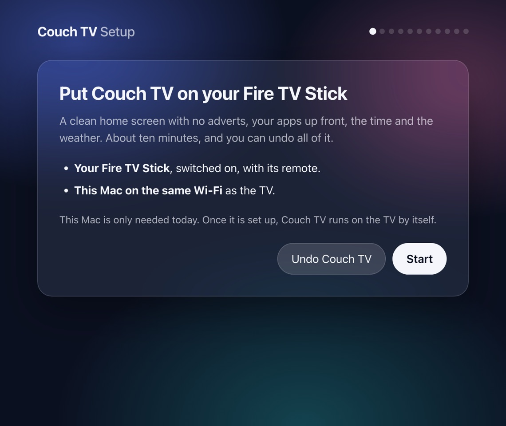
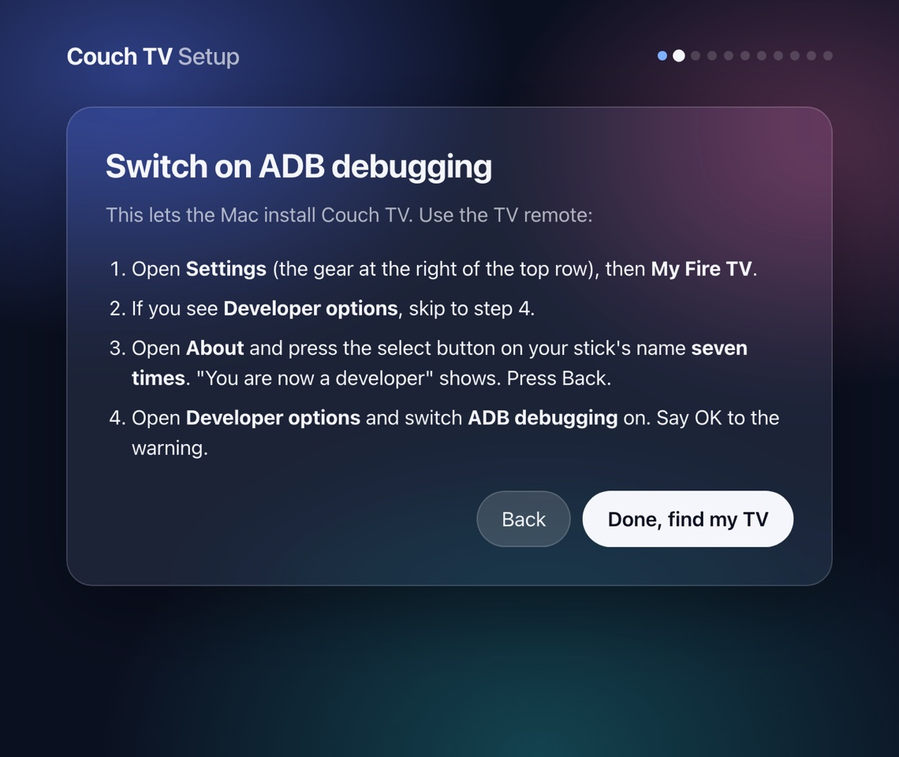
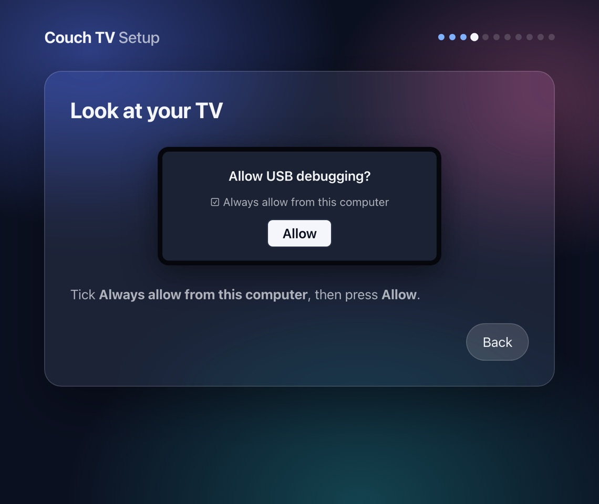

# Couch TV Setup

Puts [couch-tv](https://github.com/Seagey/couch-tv) on a **Fire TV Stick** from a Mac, with no
command line and no AI agent. It opens as a page in your browser and walks you through it: switch on
ADB debugging with the TV remote, press **Allow** on the TV, and the Mac does the rest.



> **Prototype.** Tested on a Fire TV Stick 4K (2nd gen, AFTKM) on Fire OS 8.1.8.5. Other Fire OS 7
> and 8 sticks should work the same. Fire TV sticks on **Vega OS** cannot install apps, and Google
> TV, Samsung and LG are not covered here (couch-tv itself has guides for those).

## What it does

| Step | What happens | On the TV |
|---|---|---|
| 1. ADB debugging | Step-by-step instructions for Developer options | You, with the remote |
| 2. Find your TV | Looks for the stick on your Wi-Fi, or you type its address | Nothing |
| 3. Allow | The Mac asks to connect | You press **Allow** once |
| 4. Install | Downloads the newest `couch-tv-ontv.apk` from couch-tv's Releases page and installs it | Nothing |
| 5. Home screen | The two one-off grants, "Use as home screen" switched on, and the Home watcher checked | Nothing (may flash) |
| 6. Try it | Presses Home and checks Couch TV comes up | Watch it |
| 7. Make it yours | Pairs like a phone remote, then sets the weather place, country, names and your apps in order | You read a 6-digit code |
| 8. Ads and tracking (optional) | Switches off Amazon's ad and tracking apps (never deletes them), with an Undo | Nothing |

Every step looks first and only changes what is missing, so running it again on a TV that is
already set up changes nothing.

| | |
|---|---|
|  |  |

## Use it

**Download** `Couch-TV-Setup-mac.zip` from this repo's Releases page (or the latest build under
Actions), unzip it, and open **Couch TV Setup**. The first time, macOS says it cannot check the
app: right-click it, choose **Open**, then **Open** again (or System Settings, Privacy & Security,
**Open Anyway**). It is not signed with an Apple developer account yet.

**Or from this folder:** double-click `run.command` (the first time: right-click, Open). It makes
a private Python folder for itself, then opens the setup in your browser.

When macOS asks to **find devices on your local network**, press **Allow**: that is how it reaches
the TV. The app has no window of its own. When you are done, press **Close setup** on the last screen to stop it straight away; if you just close the tab, it stops by itself about 3 minutes later.

## What it keeps on the Mac

In `~/Library/Application Support/Couch TV Setup/`:
- `adbkey`: the key the TV allows ("Always allow from this computer"). Delete it and the TV asks
  again next time.
- `switched-off.json`: which ad apps it switched off on which TV, so Undo only switches those back on.
  The same list is kept on the TV (`/data/local/tmp/couchtv-setup/switched-off.txt`), so Undo works
  from any computer.

The downloaded app is cached in `~/Library/Caches/Couch TV Setup/`. Nothing is sent anywhere
except the download from GitHub and the place search (open-meteo.com) for the weather.

## Undo

**Undo Couch TV** on the first screen puts the TV back the way Amazon set it up. It connects like
the setup (ADB debugging on, press Allow), shows exactly what it will change, then:

- takes Couch TV off the Home button and uninstalls it (its two grants go with it)
- takes its Home watcher out of the accessibility list, keeping any other app's
- switches every ad and tracking app on the setup's list back on, whoever switched it off
- presses Home and checks Amazon's home comes up (if another launcher such as Projectivy takes the
  Home button instead, it says so)

Other apps, sign-ins and settings are left alone. Afterwards, switch **ADB debugging** off again
(Settings, My Fire TV, Developer options).

By hand, with the TV remote: open the Couch TV app and choose **Stop being the home screen**, or
uninstall it (Settings, Applications, Manage installed applications). The ad apps stay off until
the setup's Undo switches them back on (or a factory reset).

## For developers

```sh
python3 -m venv .venv && .venv/bin/pip install -r requirements.txt
.venv/bin/python -m couchtv_setup              # opens the page
.venv/bin/python -m unittest discover -s tests # tests against a pretend TV
```

| Variable | Use |
|---|---|
| `COUCHTV_APK=<file>` | Install this APK instead of downloading the newest release (your own build) |
| `COUCHTV_SETUP_PORT` | A fixed port for the page (otherwise any free one) |
| `COUCHTV_SETUP_NO_BROWSER=1` | Do not open the browser |
| `COUCHTV_SETUP_ADBKEY` | Use another ADB key, for example `~/.android/adbkey` |
| `COUCHTV_SETUP_HOME` | Keep the setup's own files somewhere else |

The ADB side is pure Python (`adb-shell`), adapted from couch-tv's `tv-home/tools/tvadb.py`, so
it needs no Google `adb` and no extra Local Network permission for it. The Mac app is built by
GitHub Actions with PyInstaller (`.github/workflows/build.yml`) on every push; a `v*` tag attaches
it to a release.

### How it makes Couch TV the home screen

Fire OS does not let another app replace Amazon's home. couch-tv's on-TV app brings itself back
with an accessibility "watcher" whenever Amazon's home comes up. The setup:

1. `pm grant dev.couchtv.ontv android.permission.WRITE_SECURE_SETTINGS` and
   `appops set dev.couchtv.ontv SYSTEM_ALERT_WINDOW allow` (the two one-off grants).
2. Presses the app's own **Use as home screen** button. Fire OS refuses
   `pm enable dev.couchtv.ontv/.HomeAlias` from ADB ("Shell cannot change component state"), so the
   setup opens Couch TV's setup screen, reads it with `uiautomator dump`, moves the highlight with
   the D-pad and presses select only once the highlighted button reads exactly "Use as home
   screen". If the screen cannot be read, the page asks the person to press it with the remote.
3. Restarts the app, which then switches its watcher on itself (it needs the grant for that).
   If it did not, the setup adds the watcher to `enabled_accessibility_services`, keeping
   whatever else is there.
4. Checks the watcher is running. If not, it offers to restart the TV (Fire OS sometimes needs that
   after an install).

## Credits

[couch-tv](https://github.com/Seagey/couch-tv) by Seagey (MIT). This setup is a separate project:
it installs couch-tv's own release builds and does not change them.
